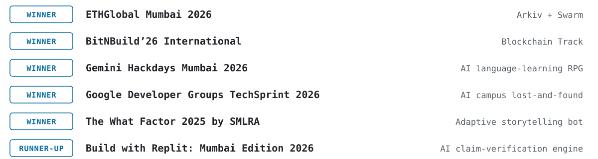
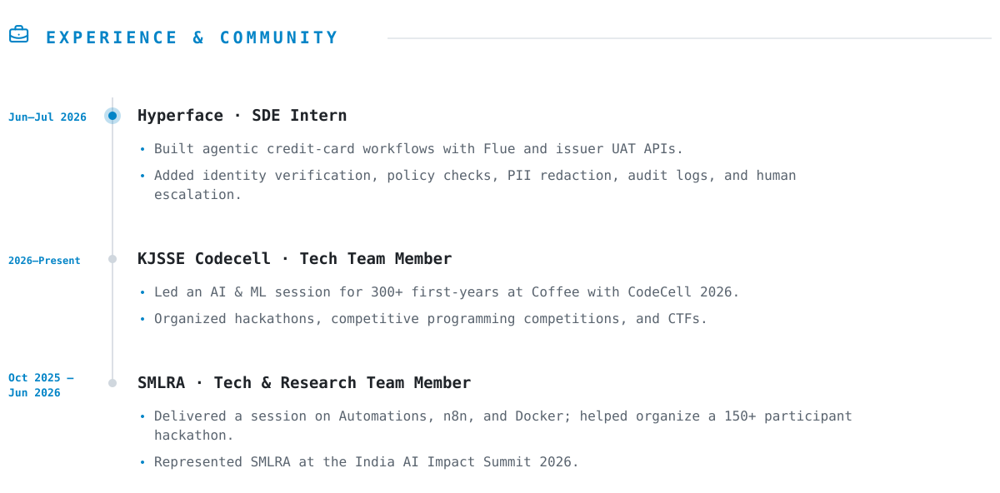

# Arav Arun

<h3>5x Hackathon Winner · AI &amp; Full-Stack Engineer · Avid Learner </h3>

<picture><source media="(prefers-color-scheme: dark)" srcset="assets/dark/awards-v4.svg" /></picture>

<picture><source media="(prefers-color-scheme: dark)" srcset="assets/dark/awards-rows-v3.svg" /></picture>

<a href="https://aravarun.in/"><picture><source media="(prefers-color-scheme: dark)" srcset="assets/dark/experience-v5.svg" /></picture></a>

<picture><source media="(prefers-color-scheme: dark)" srcset="assets/dark/stack-v5.svg" /></picture>

**Languages** 

**Web & databases** 

**AI, data & tools** 

